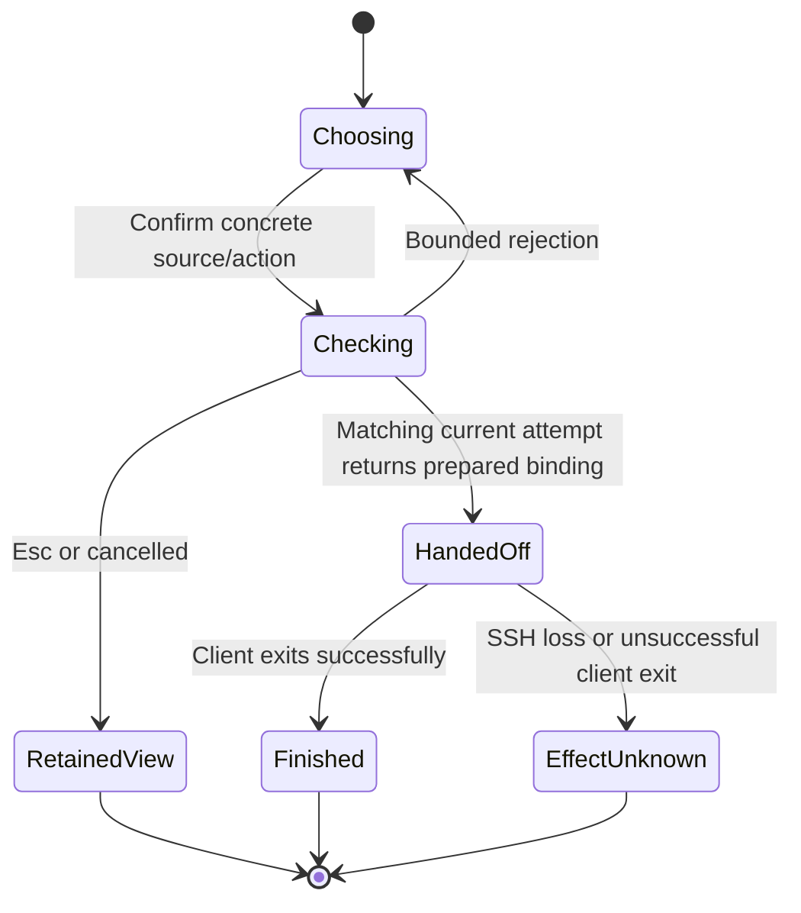

# Source-side SSH dispatch

This supplements [Program Design](2026-10-03-router-selector-program-design.md) for [R1–R10](2026-10-03-router-selector-specification.md#observable-obligations). The selected machine owns the interactive client, execution directory and session state. SSH carries terminal input/output using existing account and host trust; Router discovery and the native socket remain local to that machine. The existing HTTP inventory reader remains a read-only connection kind. This adds no advertised or network listener, tunnel, credential, session migration or default-target write. A source invocation owns one private, single-client Unix carrier adapter so the native connection it verifies is the same connection used by Codex; the Host and its advertised socket contract do not change.

```mermaid
sequenceDiagram
    actor Person
    participant Picker as Caller picker
    participant SSH as Trusted SSH
    participant Entry as Source agent-sessions
    participant API as Source CollaborationClient
    participant Carrier as Source single-client private carrier
    participant Codex as Source Codex TUI
    Person->>Picker: NEW destination or source-affine resume/fork
    Picker->>SSH: Read-only prepare (one selected source)
    SSH->>Entry: Typed request, expected service and directory
    Entry->>API: Discover actual identity, endpoints, native generation
    opt Resume or fork
        Entry->>API: Inspect exact full SessionRef
    end
    Entry-->>Picker: Prepared source/action/cwd/generation, or bounded rejection
    alt Still-current attempt
        Picker->>SSH: One interactive handoff, inherited terminal
        SSH->>Entry: Prepared action and permitted model arguments
        Entry->>API: Revalidate identity, generation, source and directory
        Entry->>API: Upgrade actual native connection, no native RPC
        Entry->>API: Fresh manifest and inventory after upgrade
        alt Exact prepared binding still matches
            Entry->>Carrier: Transfer this established native stream, no reconnect
            Entry->>Codex: Start one source client with private carrier address
            Codex->>Carrier: Native initialize and new/resume/fork
            Carrier->>API: Forward on retained generation-owned stream
        else Changed or unavailable binding
            Entry-->>Picker: Reject before starting Codex or sending native RPC
        end
        Codex-->>Person: Source terminal UI, exit status
    else Cancelled or superseded
        Picker-->>Person: Retained view; no handoff
    end
```

## Owners and shapes

| Entity | Owner and home | Representation and validity |
| --- | --- | --- |
| E1 named connection | Existing registry, modified connection profile | Name, expected service UUID, optional NEW destination cwd, plus a connection enum: existing HTTP remote fields or SSH destination/executable/serviceDirectory/clientProfile. SSH destination is one validated user@host/IP or trusted alias argument; executable/service directory are absolute source paths. No inline credential or shell program. |
| E2 service | Existing source CollaborationClient | Its authenticated local service identity and epoch must match configured stable identity and prepared epoch. SSH hostname alone never supplies identity. |
| E3 native endpoint | Existing Host inventory | Full EndpointRef, available NativeCodex channel, positive CodexGeneration and schema digest; contained relative native socket in the same service directory. NEW selects exactly codex-local, never the first arbitrary endpoint. |
| E4 prepared NEW | New source launch protocol in agent-collaboration | New {directory}; immutable prepared endpoint, native generation, schema digest, canonical validated directory and client profile. No existing session ID. |
| E5 selected session | Existing full SessionRef and source inspection | Resume {target} or Fork {target}, never bare ID. Source inspection verifies exact target and native generation and obtains actual source cwd. Stored model choice remains explicit metadata, not source identity. |
| E6 credential reference | Existing connection variant or SSH account | HTTP reference behavior unchanged. SSH consumes the existing SSH client/account configuration; no private credential is serialized. |
| E7 fork placement | Existing fork confirmation and source entrypoint | Same captured source only, qualified source cwd displayed; other-machine choices remain disabled. No imported history. |
| E8 transient view | Existing picker and reload worker | Existing source/alias binding, paging, stale-result handling and partial-source reporting preserved across both read transports. |

The new private protocol lives once in agent-collaboration and is used by both caller and source executable. All structs/enum payloads reject unknown fields. The fixed entrypoint is `agent-sessions --source-request-v1 <JSON>`; the argument is at most65536 UTF-8 bytes and contains no credentials. It is not an arbitrary remote command API.

| Request / fixed envelope | Exact fields and reply |
| --- | --- |
| `SourceRequest` | `serviceDirectory: AbsoluteSourcePath`, `expectedService: UuidIdentity`, `operation: SourceOperation`. Absolute paths are nonempty, absolute, at most4096bytes, with no control/NUL characters. No shell program or profile path. |
| `Endpoints` | No payload; success `SourceReply::Endpoints { inventory: EndpointInventory }`. |
| `NativeSessions` | `params: NativeSessionListParams`; success `SourceReply::NativeSessions { page: NativeSessionListResult }`. Existing page/view/source/cursor bounds apply, and request endpoint service must equal expectedService. |
| `ProviderSessions` | `params: ProviderSessionListParams`; success `SourceReply::ProviderSessions { page: ProviderSessionListResult }`. Same service check and existing provider API validation. |
| `Prepare` | `action: SourceSessionAction`, `clientProfile: SourceClientProfile`; success `SourceReply::Prepared { launch: PreparedSourceLaunch }`. Read-only: no native initialize or session mutation. |
| `Launch` | `prepared: PreparedSourceLaunch`, `options: SourceNativeOptions`; interactive stdout/stderr belong to the native TUI. It has no JSON success reply. Source-side validation rejection prints only a fixed category and exits2 before starting Codex. Native completion preserves child status; carrier loss/signal exits nonzero and never reconnects. |

`SourceSessionAction` is a tagged enum: `New { directory: AbsoluteRemoteCwd }`, `Resume { target: SessionRef, storedModel: SourceStoredModel }`, or `Fork { target: SessionRef, storedModel: SourceStoredModel }`. Resume/fork target is the exact source-observed hosted identity. Its `SourceStoredModel { model: Option<String>, reasoningEffort: Option<String> }` is frozen from that same source-observed picker row, never a caller-local catalog join; it is settings metadata, not identity or a claimed fresh setting. Both optional values are null or nonempty at most1024byte TOML-quotable strings without controls, quotes or backslashes, using existing ResumeModelChoice validation. Source inspection independently verifies the target/cwd/generation, not a caller-supplied cwd.

`SourceClientProfile` is `Router | RouterDebug`, mapping only to the two existing profile names. `PreparedSourceLaunch` has `action: SourceSessionAction`, `endpoint: EndpointRef`, `generation: CodexGeneration` (includes service epoch), `schemaDigest: SchemaDigest`, `workingDirectory: AbsoluteRemoteCwd`, `clientProfile: SourceClientProfile`. NEW directory comes from the configured source cwd; resume/fork directory comes from source inspection. Source validates directory existence there and retains canonical comparison metadata for revalidation; no caller filesystem test. Preparation is transient and carries no credential or held source connection across SSH invocations.

`SourceNativeOptions { model: Option<String>, reasoningEffort: Option<String>, noAltScreen: bool }` is the complete launch option shape; no raw argv list crosses the wire. Optional strings have the SourceStoredModel bounds/quotability rule. Explicit option values override frozen stored model/effort; absent values preserve source-observed stored values for resume/fork and source-profile defaults for NEW. Caller native CLI arguments may encode only model, model_reasoning_effort and no-alt-screen; conflicting duplicates, unsupported/unparseable arguments, positional prompts and every target/cwd/auth/permission/provider override reject before preparation/handoff. CLI spelling parsing is mechanics; the set of accepted values is this closed struct. Model/effort semantics remain at native Codex, not a new Selector model catalog.

Noninteractive operations always emit `SourceResponse::Ready { reply: SourceReply } | Rejected { reason: SourceRejection }`, tagged `kind`/camelCase and at most `4 * MAX_CONTROL_FRAME_BYTES` after JSON encoding. SourceReply variants above are closed; the caller requires the expected variant, full source and action tuple and current attempt. No raw error body or successful Launch result is representable here. SourceRejection is closed: `InvalidRequest`, `UnsupportedConnection`, `WrongService`, `UnavailableEndpoint`, `StaleBinding`, `InvalidNativeChannel`, `SessionUnavailable`, `DirectoryUnavailable`, `ProfilePermissionConflict`, `ConflictingArguments`, `SourceUnavailable`. Registry errors remain existing RouterRegistryError plus bounded SSH locator/path/profile categories. No variants carry an untrusted body or secret. Malformed/bannering/oversized/unknown JSON or wrong reply kind is a caller `InvalidReply`; timeout or SSH read failure is `ReadUnavailable`, separately from a valid source rejection. Input/page/source/profile errors map to their exact fixed category; IO/API/unknown internal errors map to SourceUnavailable. None returns a prepared success or local fallback.

Read operations use SSH without a PTY, no stdin, bounded stdout, a timeout and kill-on-drop. Source bounds its read/preparation work as well, so abandoning the caller does not leave an unbounded source reader. Interactive Launch uses a PTY and inherited terminal descriptors. Every remote argument is POSIX single-quoted, including embedded quotes; the validated destination is a separate argument and cannot become an SSH option. Batch authentication and strict known-host checking are required. The source process owns its single Codex child and carrier until both settle; it does not exec away the carrier owner. SSH owns terminal resize/EOF/signal transport; source HUP/TERM/cancellation terminates/reaps only its own client, drops both carrier halves and its private socket. It never deletes native session state.

## Validation and policy

Prepare performs only reads. Connect to the explicitly configured source serviceDirectory and compare the actual service UUID. Get current inventory; verify the chosen native endpoint, availability, service epoch, native generation and schema digest. Resolve the channel to a socket contained in that same directory. For NEW validate defaultRemoteCwd on the source, requiring an existing absolute directory. For resume/fork inspect the full SessionRef through the existing source API and use that session's existing absolute cwd. Reject absent sessions, wrong service/endpoint/generation, invalid directories and unqualified native channels before starting Codex. No caller-local path existence test is used remotely.

Launch repeats source validation and compares the entire prepared binding, then opens the actual native WebSocket using existing NativeTransportConnection. This sends only a transport upgrade, never native initialize/start/resume/fork. The existing Host accepts that connection under NativeGenerationGate admission before completing its frontend WebSocket upgrade (`native_relay_listener.rs`, `native_channel_relay.rs`). After this upgrade, reconnect the source CollaborationClient and re-read its manifest identity plus endpoint inventory; require expected service/epoch, exact endpoint, generation and schema to equal the prepared binding. Also revalidate source target and directory. A stale/wrong/unavailable result drops the established stream before any native RPC or Codex process.

The incarnation argument depends on existing monotonic admission: the Host never reuses a generation within one epoch; a new service has a fresh epoch; BackendPublication activates and advertises the same admission, and native generation retirement closes an already admitted stream. If the post-upgrade snapshot still equals the prepared incarnation, the upgraded stream was admitted to it. If that incarnation retires after this check, this held connection closes; it cannot be rerouted to a replacement. The stream, rather than its pathname, is retained through the creating RPC. A second native connection or automatic reconnect is forbidden. A fresh stateless API connection alone is not the held binding.

The source-side carrier adapter exists because upstream Codex accepts a Unix WebSocket address, not an already-upgraded descriptor. Inside a fresh mode0700 temporary directory, the source action owner binds one mode0600 Unix socket and accepts exactly one Codex frontend. It forwards bounded WebSocket messages bidirectionally to the already-established, post-validated native stream, preserving initialize and all native payloads without decoding, manufacturing, reordering or replay. At most one message per direction is retained under backpressure and the existing64MiB native frame/message bound applies. After one accept the listener is closed. This address is supplied only to the one owned child, never published in Router inventory, TCP-bound, tunneled or reused. The adapter performs no native initialization of its own. Native/backend EOF/error, frontend EOF/error, owned-child exit, caller HUP/TERM or cancellation ends forwarding and reaps that child; temporary socket/directory cleanup is scoped to this invocation. No session deletion or Host/default/profile mutation occurs. One Tokio runtime owns preparation, adapter, child process and signal IO; synchronous resolver block_on is not called inside it.

```mermaid
sequenceDiagram
    participant Source as Source action owner
    participant Gate as Existing native generation gate
    participant Stream as Established native stream
    participant Child as Source Codex child
    Source->>Gate: Upgrade native carrier (no native RPC)
    Gate->>Stream: Admit current incarnation G
    Source->>Gate: Fresh API/manifest observation after upgrade
    alt Prepared G differs from current observation
        Source->>Stream: Drop; no child and no native RPC
    else Prepared G matches
        Source->>Child: One private frontend backed only by Stream
        Child->>Stream: Existing native initialize and action
        opt G retires at any point
            Gate->>Stream: Close via existing retirement token
            Source->>Child: End/reap; never connect replacement G+1
        end
    end
```

The required event-controlled proof places a replacement after final preflight but before native acceptance: post-upgrade validation must reject and the backend sees zero initialize/action frames. A second case retires G after successful post-upgrade validation but before the first forwarded native action: the held stream closes and replacement G+1 sees zero frames. The accepted path must forward the real child's initialization/action exactly once. These observations qualify this private composition; another pathname recheck does not.

The source's existing Router or RouterDebug profile and configuration own native settings. The new path forwards no caller approval/sandbox/provider configuration. NEW uses the source client's existing permitted defaults, just as an invocation on that source does; native Host policy remains authoritative. Resume/fork preserve saved permissions through the existing native contract, and the existing profile-permission guard remains enforced. No profile is rewritten. A debug profile's proxy port is not changed to accommodate a test. Actual acceptance must inspect source settings and traffic location; configuration alone is not policy proof.

## Pending actions and failure



The picker owns one pending attempt identity. Checking locks focus and main/background input; Escape abandons the attempt, restores the retained view and invalidates its eventual result. The existing Tokio/iocraft async hook performs read-only preparation without blocking rendering or resize. Only a result matching the current action, source and attempt may become a launch outcome. Repeated Enter does not start another preparation. A preparation failure leaves NEW's chooser or fork popup visible with a bounded reason; resume failure leaves a bounded source error. Background inventory refresh cannot replace a captured action.

After returning the prepared outcome, the process runner attempts one SSH handoff. A failure before spawn is a pre-handoff failure. Once SSH has started, nonzero exit or loss is conservatively effect unknown: do not retry, choose another Router, delete a possible session or create a local substitute. The native source session is the recovery authority. There is no durable operation ledger or automatic reconnection mechanism.

## Requirement-to-realization trace

| U | R / contract | E | Owner / interface | Shape and home | State | Failure | Proof seam |
| --- | --- | --- | --- | --- | --- | --- | --- |
| U1,U3,U4 | R1 / C1 JSONC | E1,E2,E6 | Registry parse | Existing profile, new tagged SSH kind | configured/rejected | fixed diagnostic, no secret echo | Real registry parser accepts SSH and rejects injection/invalid paths |
| U2,U3,U8 | R2 / C2 NEW | E4,E5,E8 | Picker pending action | Prepared source launch protocol | choosing/checking/current handoff | cancel/late result cannot launch | Real component + pending cancellation + actual SSH NEW |
| U3,U8 | R3 / C2 defaults | E1,E4,E5,E8 | Existing dispatcher | Existing default/local outcomes unchanged | default | unused registry cannot reroute | Existing default/local command contracts |
| U2,U3 | R4 / C3 execution/cwd | E4,E5 | Source entrypoint + native client | Source-validated directory in prepared action | prepared/handed off | destination-only path validated there | Actual two-machine session and execution cwd readback |
| U4,U5 | R5 / C3 identity | E2,E3,E4 | Source API and launch validator | EndpointRef, generation, schema digest | verified/stale | wrong tuple cannot exec | Literal wrong-service/epoch/channel tests plus actual route |
| U4,U6 | R6 / C4 credentials | E1,E6 | SSH and existing references | No secret in request/argv | authenticated/rejected | no trust bypass | Captured argv/output and strict-host/auth failure |
| U2,U3 | R7 / C5 uncertainty | E2,E3,E4,E5 | One-shot process runner | Typed preflight failure vs unknown effect | finished/unknown | no replay/fallback | Process failure after handoff, native state, no second create |
| U6 | R8 / C6 scope | E1–E8 | Existing product owners | No exposure/schema/session copy | unchanged | no production/global writes | Source diff and isolated runtime/protected process inspection |
| U3,U5,U7,U8 | R9 / C7 fork | E2,E3,E5,E7 | Fork popup + source entrypoint | Exact source, actual source cwd | pending/same-source handoff | disabled/cancel/stale no fork | Real same-source fork on each machine, parent unchanged |
| U3,U4,U5,U7,U8 | R10 / C8 inventory | E1,E2,E3,E5,E8 | Existing loader over SSH read adapter | Existing inventory/page schemas | loading/partial/ready | no default fill or stale publication | Actual individual/All inventory, duplicate identity, source action |

## Tradeoffs and preserved boundary

Source-side SSH avoids externally exposed native listeners and leaves credentials, state and execution on their existing machine. Selector pays for the typed source entrypoint, one private single-client native carrier and owned child/TTY lifecycle; operators supply a trusted SSH destination, matching agent-sessions executable and existing source Router. Without the private carrier, execing Codex by pathname reopens the validation-to-connect race; deleting it therefore violates R5/R9. Changing the Host to expose generation-specific sockets would affect all native consumers and is larger than this invocation-local composition. The alternative caller-local native client would require an exposed, service-bound authenticated native route that the current Host does not supply. Neither option justifies a new exposure subsystem. Source profiles may reject launch; that is a visible error, not permission to rewrite policy. Existing non-Codex provider inventory remains readable; interactive provider rows remain unsupported in this launcher, without altering their advertised capabilities.

The two Macs have different installed native versions/schema digests. Each is qualified locally, never assumed interchangeable. Real remote action, interrupt, resize, terminal paste and post-disconnect uncertainty remain unverified until exercised through the compiled path. The previous two-machine setup proves readiness only. No remote-action success is inferred from the existing UI storyboard or green CI.
