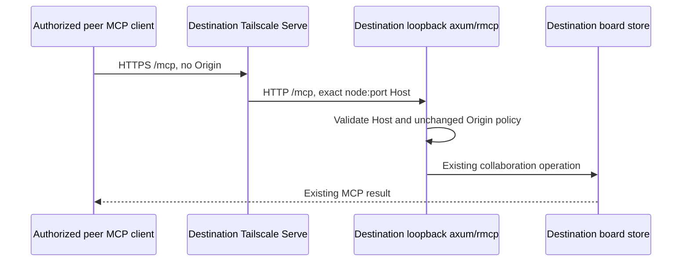

# Host-owned Tailscale Serve exposure

Requirements: [requirements.md](requirements.md). Observable contract: [specification.md](specification.md). The owner accepted the private automatic Host-exposure direction; the exact reversible implementation choice is foreground Tailscale Serve over the existing loopback HTTP MCP listener, explicitly selected by the owner after the Unix route required administrator privileges.

## Current foundation and chosen change

The Host already owns the collaboration application, authoritative board store, local Unix HTTP socket `agent-communication/control.sock`, loopback MCP TCP listener and teardown. `--mcp-bind` deliberately rejects non-loopback addresses. Tailscale is installed on both owner machines, current direct ping/SSH and SSH-carried MCP reads work both ways, and local tailnet HTTPS capability is enabled. Those observations do not establish Serve or remote board behavior.

Use foreground Tailscale Serve’s ordinary HTTP reverse proxy to the Host’s existing `http://127.0.0.1:<mcp-port>` listener (or its actual validated loopback address). Mount `/` so incoming `/mcp` remains `/mcp`. Serve preserves the incoming HTTPS Host authority, including the selected port. The loopback MCP router therefore accepts one additional exact authority, `<validated-node-dns>:<https-port>`, only for this opted-in invocation. It retains the existing loopback Host entries and identical existing HTTP loopback Origin allowlist; it never adds the tailnet HTTPS Origin, clears validation, accepts arbitrary hosts or binds a public/LAN interface. Unix clients stay unchanged. Tailscale encrypts/terminates private HTTPS and enforces the existing tailnet policy; board actors retain their existing meaning.

This route keeps the Host unprivileged, avoiding the Unix/path Serve permission requirement observed from the installed daemon. It costs one explicit proxy-authority input at the existing MCP listener boundary and matching tests. The owner accepted that tradeoff. No custom reverse proxy, credential/token store, board replica, native transport, sudo or operator-policy change is introduced. The external URL is private node HTTPS; HTTP is confined to that computer’s loopback interface.

## Owners and types

- CLI HostCommand owns optional typed `RemoteAccess` and a nonzero HTTPS port. Its replacement command preserves them. CLI display names the computed HTTPS URL; existing version3 service manifest local URL remains unchanged.
- `codex-router-host` HostConfig carries the validated exposure choice through an optional builder, preserving existing constructor consumers.
- The existing MCP listener type gains an optional validated proxy authority on its loopback variant, carried as a DNS authority with required nonzero port. All in-workspace constructors are cut over together. The alias comes only from successful opt-in Tailscale preflight, not request headers, environment overrides or a general user-controlled allowlist.
- CollaborationRuntime owns an optional `TailscaleExposure` alongside its existing listeners. A focused module owns status/preflight parsing, argv, owned child, readiness and cleanup. The board store and MCP schema have no second owner.
- Use typed Serde DTOs for required fields from `tailscale status --json` and Serve status. Unknown payload fields can be ignored; do not copy user/profile secrets or entire status into public artifacts. Bound subprocess output and all startup/wait calls.

## Lifecycle and call path

`host` parse → normal isolated/production mode and singleton validation → Tailscale node/port preflight when opted in → existing MCP socket/listeners with the single validated proxy authority → one foreground `tailscale serve --bg=false --https=<port> --set-path=/ http://<actual-loopback-mcp-address>` child → HTTPS readiness against intended service → ready URL. Default mode omits every Tailscale call. Use one existing Tokio runtime, no shell-generated commands or nested runtime.

Preflight produces a prepared exposure containing the validated node authority, loopback backend and unused external port; starting it owns the Serve child only after the listeners exist. No additional global state is needed. Preflight requires running Tailscale, valid node DNS name/HTTPS capability, and an unused selected port including foreground and background Serve/Funnel state. Refuse collision instead of replacing another owner. No `--yes` or admin-console consent automation. Startup failure removes only the just-created owned foreground session and reaps its child. Runtime exposure failure is a new typed fatal case, not the existing local-listener failure arm. `CollaborationRuntime::listener_failure` and the thin collaboration lifecycle owner return a discriminated `CollaborationFailure` with local-listener versus tailnet-exposure variants; update every in-workspace consumer in one cutover. Local-listener failures retain their established log-and-close behavior. On tailnet-exposure failure, the Host event loop invokes its existing `settle_for_shutdown` ownership path for active work and owned Router/app-server, then returns an explicit Host error. Startup exposure failure uses the existing collaboration-startup failure cleanup. No separate recovery loop or generic host-failure framework is added. Shutdown requests the owned Serve child exit, joins/reaps it, verifies its foreground session removal and leaves other configurations unchanged. The daemon’s session attachment owns foreground config removal; do not run Serve reset. Drop remains a bounded kill-on-drop fallback, not proof of completed cleanup.

Remote calls travel peer HTTPS → Tailscale policy/Serve → the same loopback MCP application → destination board store → real readback. They never touch the native relay or operator socket. Tailnet identity headers are not elevated into new board identity; permitted peers receive the existing MCP capability. Existing browser Origin behavior stays unchanged. No new persisted wire/schema format or credential is required.

## Failure and proof seams

Parser negative/positive cases; exact HTTP backend argv and exact proxy-authority matching; bounded malformed/offline status and TLS prerequisite errors; no-call disabled mode; config collision/no-overwrite; real owned subprocess early-exit/shutdown/reap; restart projection. Tests may inject process executable at the internal construction boundary only, retaining the real supervisor. Product proof then uses actual installed Tailscale and current normal debug Hosts on both machines: private URL, service-affine MCP inventory, own test-board post/readback, cross-Origin rejection and cleanup plus protected process/config identities. No model prompt is needed for board proof.

The independent review and implementation readiness state live outside these governing documents. Existing Selector source-SSH and Details plans govern their own unchanged work and proof. The Lead integrates the isolated Host change into the requested delivery only after source assessment and affected checks.

## HTTP trust and call boundary

The listener constructor receives `LoopbackTcp { address: SocketAddr, proxy_authority: Option<validated DNS authority with port> }`; Unix remains its separate variant. The Host supplies `None` when remote access is absent. The proxy authority is accepted only as Host, never as browser Origin. A wrong node, wrong port, or remote browser Origin is rejected before running a tool. Readiness verifies the intended service ID and epoch over normal certificate-validated HTTPS. Default/local behavior, typed fatal exposure failure and existing shutdown ownership remain as specified above.

HTTPS authority follows the protocol’s default-port rule: when selected HTTPS port is443, an omitted port on the exact node Host denotes443. The MCP boundary canonicalizes only that exact bare node Host to `node:443` before rmcp validation; an explicit different port is still rejected. It never adds a bare DNS entry to rmcp’s allowlist (that would accept arbitrary ports). Non443 exposure requires the explicit selected port. Origin headers and the existing Origin allowlist are never rewritten. This normalization owns only this opt-in proxy authority at the existing axum/rmcp boundary.

## Cold certificate readiness budget

Tailscale Serve obtains the node certificate on demand. Its pinned daemon TLS owner gives ACME acquisition up to one minute before it can present the certificate. HTTPS capability and node identity do not imply that a certificate is already cached. Keep this acquisition inside the existing foreground Serve path; the Host does not export keys, install trust, issue a second certificate command or change Tailscale policy.

The existing read-only HTTPS readiness sequence allows a 65-second request and a 75-second total budget. That covers the daemon certificate window and the two bounded MCP reads, while preserving normal chain/hostname validation, no redirects/proxy escape, response bounds, service/epoch checks and zero request replay. A warm node completes immediately; a first start can wait roughly a minute for its certificate. This latency is borne by the opted-in Host startup, not the Tokio executor or default local-only Host. Finite Tailscale commands retain their five-second bound and foreground advertisement/cleanup bounds remain unchanged.

Qualify this client budget through an event-controlled actual HTTP response hold of 35 seconds crossing both the old ten-second request and fifteen-second total limits, with a separately expired total readiness request as the failure control. This proves the client configuration and deadline behavior, not ACME or successful TLS. Retain actual private HTTPS and both-machine proof separately.
